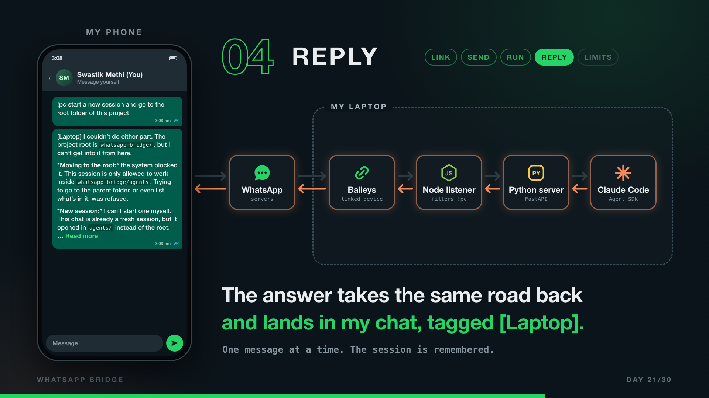

# WhatsappBridge

Text a task to your own WhatsApp chat. Claude Code on your laptop does the work and replies in the same chat.

```
You:      !pc list the PDFs in my Downloads folder
Laptop:   [Laptop] I found 3 PDFs: ...
```

## Demo

[](docs/demo.mp4)

Click the image to watch the 41-second walkthrough.

## How it works

```
WhatsApp  →  Baileys  →  Node listener  →  Python server  →  Claude Code
(phone)      (linked     (index.mjs)       (app.py,           (agents/claude.py,
              device)                       FastAPI)           Claude Agent SDK)
```

The reply takes the same road back and lands in your chat, tagged `[Laptop]`.

- **Only your own chat.** The listener reacts only to messages you send to yourself ("Message yourself") that start with `!pc`. Every other chat and every ordinary note is ignored.
- **One conversation.** Messages are handled one at a time, and the Claude session is remembered between messages. Delete `.claude-whatsapp-session` to start a fresh one.
- **Local only.** The Python server listens on `127.0.0.1:8200`. Nothing is exposed to the network.

## Requirements

- Node.js 20 or newer
- Python 3.10 or newer
- [Claude Code](https://claude.com/claude-code) installed and signed in (`claude` must work in your terminal)
- A WhatsApp account on your phone

## Setup

```bash
git clone https://github.com/SwastikMethi/WhatsappBridge.git
cd WhatsappBridge

npm install

python3 -m venv .venv
.venv/bin/pip install fastapi uvicorn python-dotenv claude-agent-sdk
```

A `.env` file in the project root is optional. If it exists, it is loaded before Claude runs.

## Run

```bash
./start.sh
```

This starts the Python server and the WhatsApp listener in the background. Logs and process ids go to `.run/`.

On the first run nothing is linked yet, so the script shows a QR code. On your phone open WhatsApp → Linked devices → Link a device and scan it. Press Ctrl-C once the log says `opened connection`; the bridge keeps running. Later runs reuse the saved link.

```bash
./stop.sh
```

Then send yourself a message that starts with `!pc`.

## What Claude can do

Set in `agents/claude.py`:

- Works in this project folder, plus `~/Documents`, `~/Downloads` and `~/Desktop`.
- Can read and search files without asking, and edits are accepted automatically.
- No MCP servers are loaded.
- At most 15 agent steps and 120 seconds per message. Messages are capped at 4,000 characters.

## Security

- `auth_info_baileys/` is a full login to your WhatsApp account. `.env` and `.claude-whatsapp-session` are private too. All three are in `.gitignore`; never commit or share them.
- Anyone who can send messages from your WhatsApp account can run tasks on your laptop. Tighten the tools and folders in `agents/claude.py` to what you actually need.
- To unlink the laptop, remove it under WhatsApp → Linked devices and delete `auth_info_baileys/`.
- Baileys is an unofficial WhatsApp Web library and is not endorsed by WhatsApp. Use it on your own account, at your own risk.

## Limits

One plain chat is the whole interface: no second conversation, no way to switch projects or sessions from the phone, and no MCP or plugin settings.
